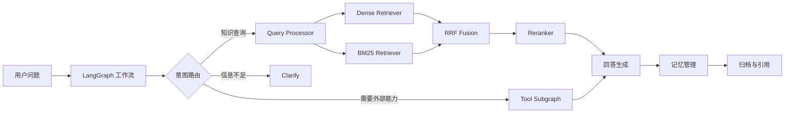

# Cognivault

> 一个面向真实知识库场景的 Agent 工作台：让文档、记忆、检索和工具调用共同参与回答。

[](https://www.python.org/)
[](https://langchain-ai.github.io/langgraph/)
[](https://fastapi.tiangolo.com/)
[](https://modelcontextprotocol.io/)

## 这是什么

Cognivault 不是一个只把问题丢进向量库的 RAG Demo。它把一次问答拆成一条可以观察、调试和替换的认知链路：

```text
用户问题
   ↓
意图判断 / 指代消解 / 子查询拆分
   ↓
Dense 语义检索 + BM25 关键词检索
   ↓
RRF 融合 + 可选 Rerank
   ↓
上下文、会话记忆、长期记忆、工具结果
   ↓
带引用的回答 + Trace
```

系统同时支持知识库问答、工具调用和澄清式对话。遇到需要外部信息的问题，Agent 可以从 RAG 分支切换到工具子图，而不是把所有问题都强行塞进知识库。

## 核心能力

| 能力 | 实现思路 |
| --- | --- |
| 多格式摄取 | 支持 PDF、Word、Excel、PPT、Markdown、HTML、TXT、CSV、JSON、YAML 等格式 |
| 混合检索 | Dense 向量检索与 BM25 稀疏检索并行执行，再通过 RRF 融合排序 |
| 查询处理 | 支持意图路由、查询重写、指代消解和子查询拆分 |
| Agent 工具调用 | 基于 LangGraph 子图执行 ReAct 式工具调用，并兼容 MCP Server |
| 记忆管理 | 滚动窗口压缩、长期记忆提取、会话归档和消息回滚 |
| 多模态理解 | 文档图片提取、图片存储和 Vision LLM 描述增强 |
| 可观测性 | Trace 上下文贯穿摄取、检索、工具和生成流程，配套 Dashboard |
| 质量评估 | 提供单元测试、集成测试、E2E 测试和 RAG 评测脚本 |

## 架构一览



### 一次文档上传会发生什么

```text
文件完整性校验
  → Loader 解析
  → Chunker 分块
  → 元数据 / 图片增强
  → Dense + Sparse 编码
  → Chroma / BM25 索引
```

每个会话拥有独立的知识集合，文件不会默认混入其他会话；检索结果保留来源信息，回答可以回溯到具体文档和 chunk。

## 设计取舍

### 为什么同时使用 Dense 和 BM25？

向量检索擅长理解同义表达，BM25 擅长命中产品名、编号、数字和专有名词。两者的分数不在同一量纲，因此使用 RRF 按排名融合，避免为了融合而强行归一化不同模型的分数。

### 为什么把工具调用拆成子图？

工具调用有自己的循环、最大迭代次数和失败处理策略。将它放进独立子图后，主 RAG 工作流只关心“调用工具”这个能力，具体工具可以来自内置注册表，也可以来自 MCP Server。

### 为什么保留 Trace？

RAG 的问题往往不是“模型完全不会回答”，而是某一步出了偏差：意图识别错了、召回不对、重排把结果打乱，或者记忆污染了上下文。Trace 让每个节点的输入、输出、耗时和状态都能被定位。

## 项目结构

```text
cognivault-rag/
├── config/
│   ├── settings.yaml              # 统一配置
│   └── prompts/                   # 分块、描述、元数据等 Prompt
├── frontend/                      # Vue 3 + Element Plus 工作台
├── src/
│   ├── core/                      # Settings、类型、查询引擎、响应和 Trace
│   ├── ingestion/                 # 文档摄取流水线
│   ├── libs/                      # Loader、Embedding、LLM、Reranker、VectorStore
│   ├── mcp_server/                # MCP Server 与工具处理器
│   ├── observability/             # 日志、Dashboard、评测和 Benchmark
│   ├── ragent_backend/            # FastAPI + LangGraph 对话工作流
│   └── tool_agent/                # 工具注册、适配器和工具子图
├── tests/                         # unit / integration / workflow / e2e
├── docs/DEVELOPMENT_LOG.md        # 可核验的工程演进记录
├── main.py                        # MCP Server 入口
└── start.bat                      # Windows 启动脚本
```

## 快速开始

### 环境要求

- Python 3.10+
- Node.js 18+
- PostgreSQL（会话归档和 checkpoint）
- 一个兼容 OpenAI API 格式的 LLM / Embedding 服务

### 安装

```powershell
git clone https://github.com/uhhgxg/cognivault-rag.git
cd cognivault-rag

python -m venv .venv
.\.venv\Scripts\Activate.ps1
pip install -e ".[dev]"

Copy-Item .env.example .env
```

然后根据本地环境填写 `config/settings.yaml` 或 `.env` 中的模型、Embedding、数据库和 MCP 配置。

### 启动后端

```powershell
python -m src.ragent_backend.app
```

### 启动前端

```powershell
cd frontend
npm install
npm run dev
```

打开 Vite 输出的本地地址即可进入 Cognivault 工作台。

## 配置约定

现有后端包路径仍是 `src.ragent_backend`，环境变量仍使用 `RAGENT_*` 前缀，这是为了兼容已有启动脚本和配置；公开产品名称和 Python 包名已经统一为 Cognivault / `cognivault-rag`。

常用配置包括：

```text
RAGENT_LLM_PROVIDER
RAGENT_LLM_MODEL
RAGENT_LLM_API_KEY
RAGENT_EMBEDDING_MODEL
RAGENT_POSTGRES_URL
RAGENT_MAX_MESSAGES
RAGENT_KEEP_RECENT
```

## 测试与验证

先运行不依赖真实模型和完整浏览器链路的测试：

```powershell
python -m compileall src
python -m pytest -m "not llm and not e2e"
```

需要真实 API、PostgreSQL 或外部 MCP Server 的测试，请先完成对应配置，再按测试标记执行。

## API 能力

后端提供以下几类接口：

- 会话创建、切换、历史消息加载和回滚；
- 文件上传、解析状态查询和文件删除；
- 同步问答与 SSE 流式问答；
- 检索来源查看和会话级知识库隔离；
- 健康检查与 Trace WebSocket 推送。

接口细节见 [docs/api.md](docs/api.md)，源码导读见 [PROJECT_ARCHITECTURE_SUMMARY.md](PROJECT_ARCHITECTURE_SUMMARY.md)。

## 工程记录

项目的可核验演进记录放在 [docs/DEVELOPMENT_LOG.md](docs/DEVELOPMENT_LOG.md)，内容围绕存储迁移、工具层、LangGraph 路由、前后端联调和评测流程展开。

## License

MIT
